# SimpleUstbBlue Beamer Theme

一个面向学术与科研汇报的简洁深蓝色 Beamer 主题，基于 [SimpleDarkBlue Beamer Theme](https://github.com/pm25/SimpleDarkBlue-BeamerTheme)  修改而来，针对 University of Science and Technology Beijing（北京科技大学，USTB）的汇报场景做了定制。

**SimpleUstbBlue Beamer Theme** 是在原版 SimpleDarkBlue 主题基础上二次开发的 LaTeX Beamer 模板。它保留了原主题简洁、深蓝配色、适合学术汇报的整体风格，同时简单优化中文及相关适配以便于校内课程报告、开题/答辩、组会与学术会议使用。

- 原项目主页：https://github.com/pm25/SimpleDarkBlue-BeamerTheme
- 原项目 CTAN：https://ctan.org/pkg/beamertheme-simpledarkblue

感谢 [DeepSeek](https://www.deepseek.com/) 在配色定制与 Beamer 细节适配过程中的帮助。

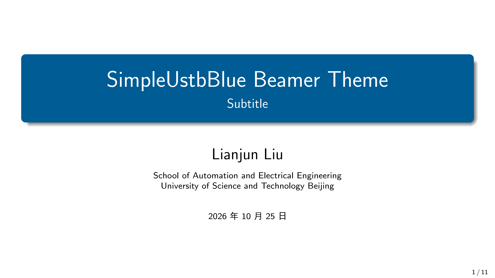

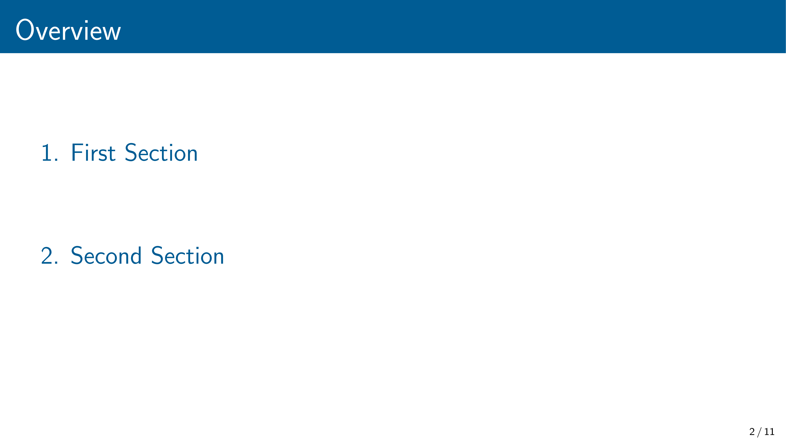

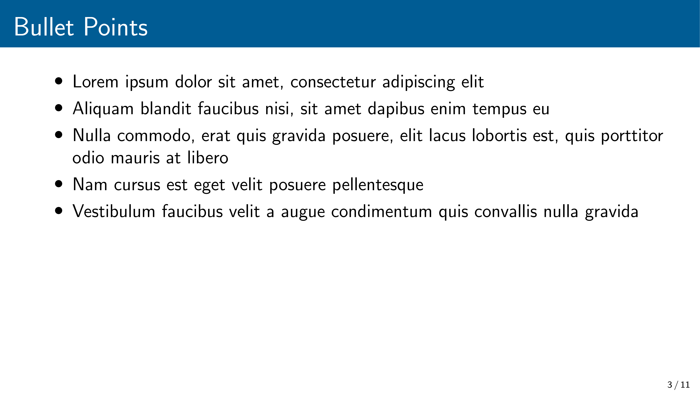

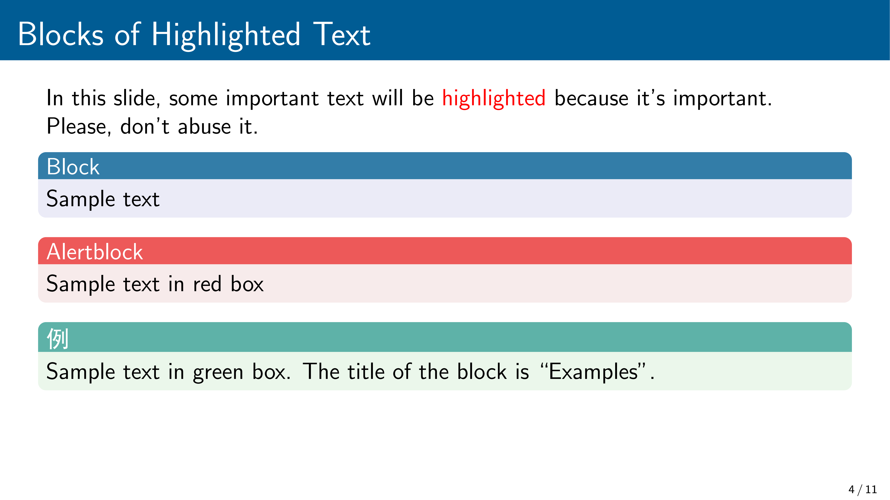

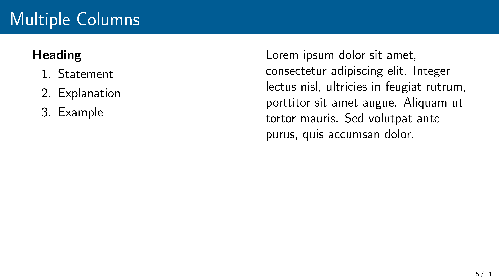

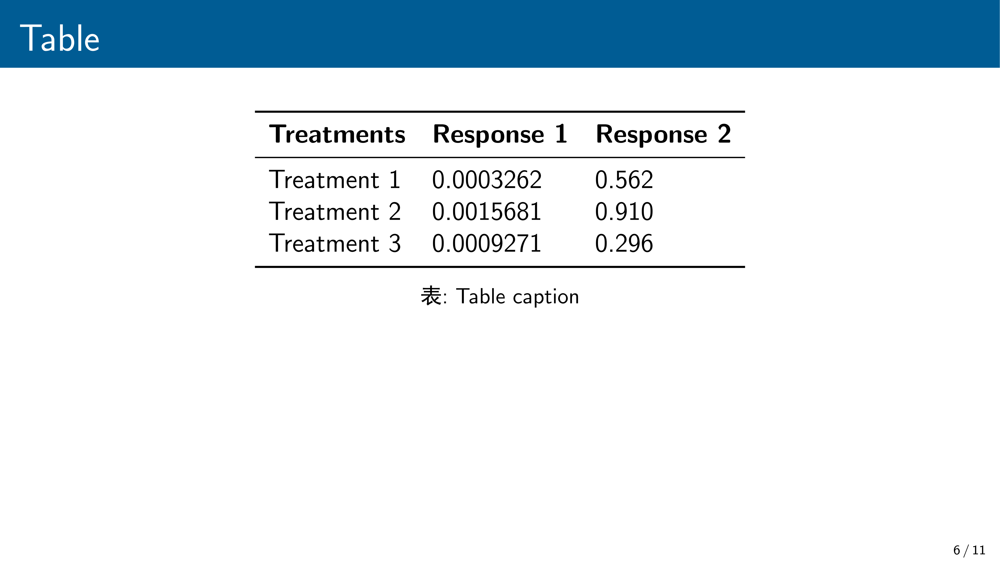

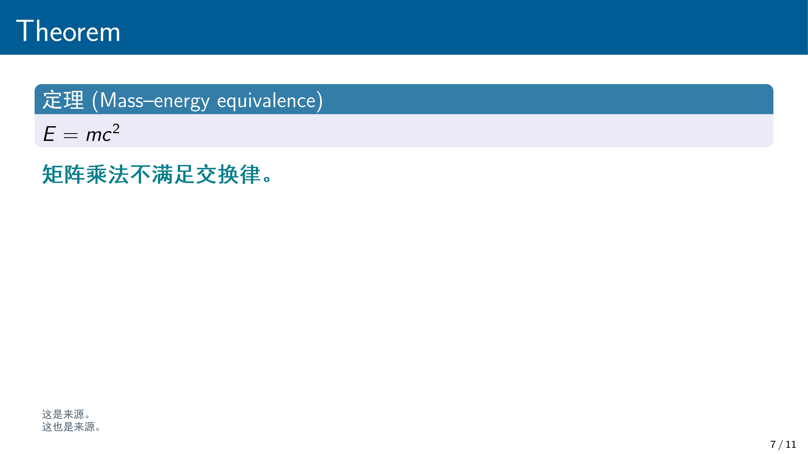

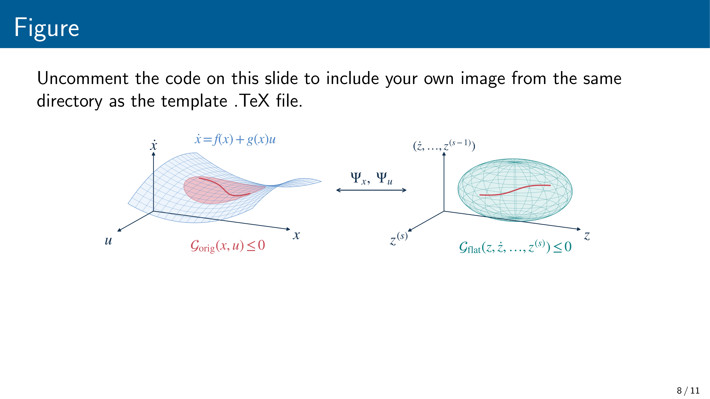

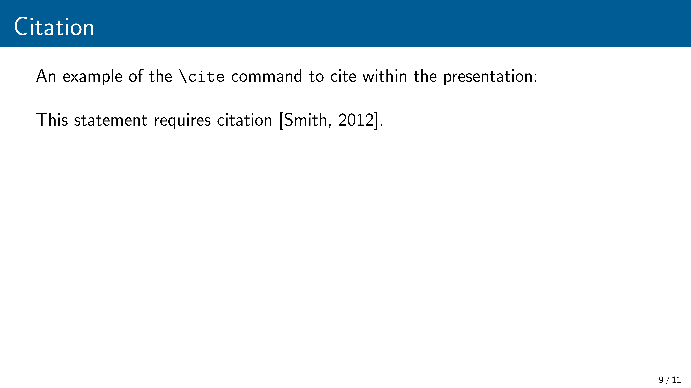

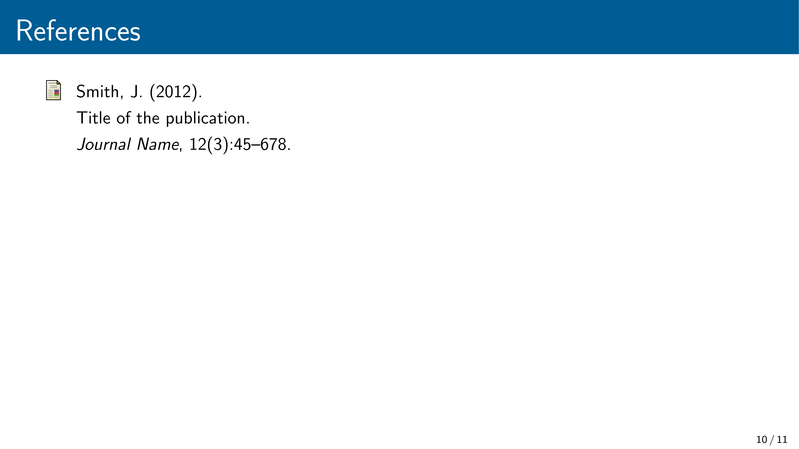

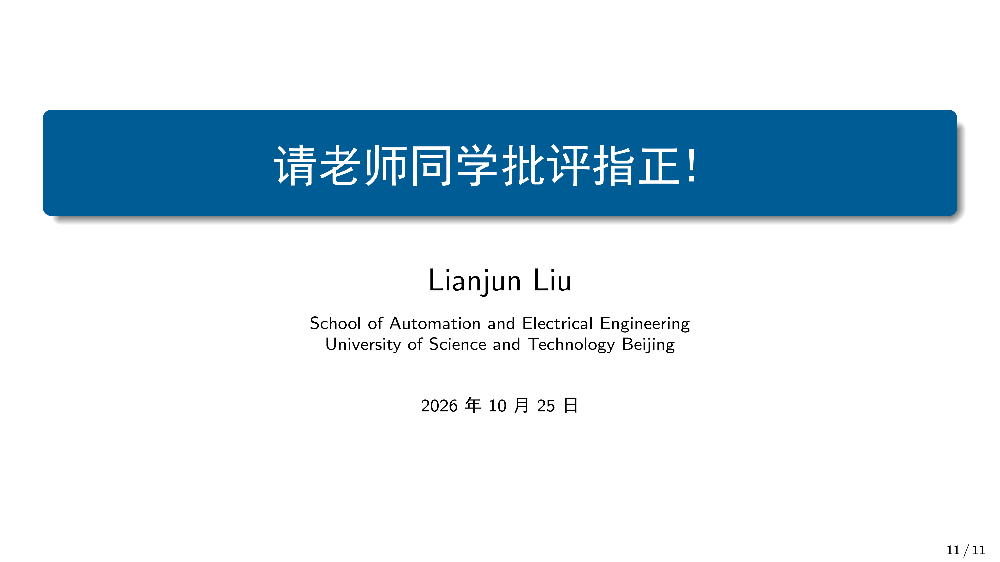